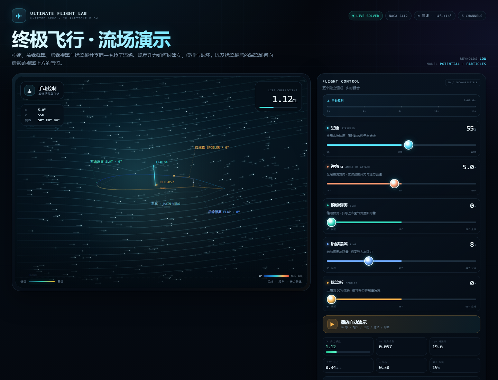
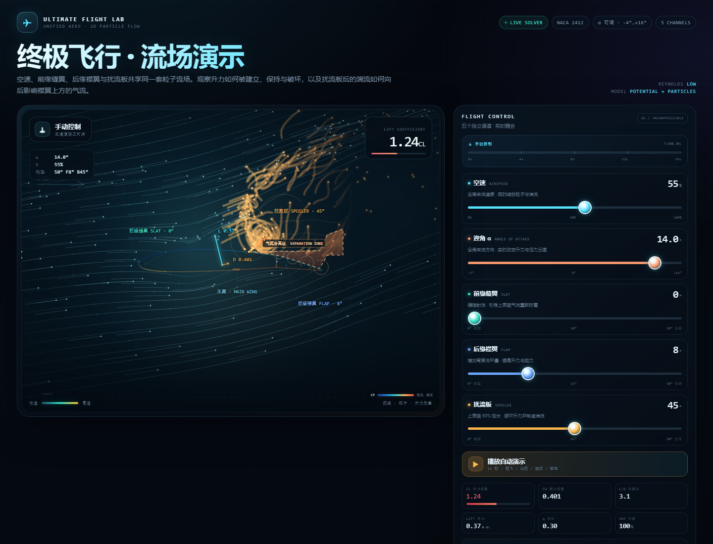

# 终极飞行 · Ultimate Flight Sim

> 一款运行在浏览器里的、单文件的二维空气动力学交互演示。  
> 五个独立控制通道，实时压力云图、分离区、粒子流场与 16 秒自动飞行剖面。
>
> **Live demo:** https://jklin6632-dot.github.io/ultimate-flight-sim/  
> **Desktop edition** · 单 HTML · 零运行时依赖 · 不需要构建



## 这是什么？

这是一个面向教学、演示和视觉探索的 **2D 气动趋势模型**，不是工业 CFD。

它把 NACA 2412 翼型、前缘缝翼、后缘襟翼、60% 弦长扰流板放在同一个画布和同一套粒子场里，让你可以拖动滑条，直观看到：

- 迎角增大时，上表面吸力峰增强、压力云图变蓝，升力系数上升；
- 放下前缘缝翼时，缝道喷流贴着上表面加速，抑制前缘分离；
- 放下后缘襟翼时，环量增加、后缘下洗增强、升力上升；
- 拉起扰流板时，上表面气流被强制破坏，出现分离区、琥珀色湍流尾流和升力骤降；
- 空速提高时，粒子、湍流强度和尾流速度同步增加。

界面走深色航空仪表风格，桌面端是「大画布 + 右侧控制台」，手机端自动切换为单列；页面中心始终是流场，所有参数都能实时重算。



## 核心特性

| 特性 | 说明 |
|---|---|
| **单文件** | CSS、JavaScript、Canvas 绘制全部内联，没有 CDN、WebGL、后端或构建步骤 |
| **五通道实时控制** | 空速 0–100%、迎角 -4°–16°、前缘缝翼 0–20°、后缘襟翼 0–30°、扰流板 0–90° |
| **翼面压力云图** | 上表面低压深蓝、下表面高压橙红，随 α / 襟翼 / 扰流板实时变化；右下角有 Cp 色标 |
| **分离区** | 大迎角或扰流板升起时，在上表面后方绘制半透明 hatched 区域、虚线边界和「气流分离区 / SEPARATION ZONE」标签 |
| **分离区粒子湍流** | 进入分离区的粒子被强制标记为 rough，叠加强涡旋、行波和高频扰动 |
| **CL 动态仪表** | 画面右上角与底部数据栏都有 CL 柱状条；高 CL 绿色，失速琥珀，扰流板导致升力暴跌时红色闪烁 |
| **16 秒自动飞行剖面** | 起飞爬升 → 巡航 → 降落进近 → 触地减速，五个滑块自动锁定/解锁 |
| **尾流渐隐** | 扰流板后方的琥珀色粒子随 x 向右逐渐降低 Alpha，避免遮挡后方视野 |
| **自适应粒子数量** | 按画布面积在约 140–380 个粒子之间调整，兼顾手机性能与桌面密度 |
| **移动端适配** | 390 / 320 宽度下无横向溢出，滑条触控高度 46px，按钮和读数按单列重排 |
| **可复现的验证** | 纯前端，无外部请求；可用 Edge / Chrome 直接打开或本地静态服务器运行 |

## 快速开始

### 方式一：直接打开

下载或克隆仓库后，双击：

```text
index.html
```

即可在浏览器中运行；`ultimate_flight_sim.html` 是同一份桌面版单文件，便于单独分享。

### 方式二：本地静态服务器

```bash
# 任选一种
python -m http.server 8080
# 或
npx serve .
```

然后打开 <http://localhost:8080/>。

> 不需要安装依赖，不需要 npm install，也不需要联网。  
> 页面本身不发起任何外部 HTTP 请求。

## 操作说明

| 控件 | 范围 | 作用 |
|---|---|---|
| 空速 Airspeed | 0–100% | 全局来流速度；同时缩放粒子速度与湍流强度 |
| 迎角 α | -4°–+16° | 改变来流方向、升力系数、压力云图和分离趋势 |
| 前缘缝翼 Slat | 0°–20° | 从主翼前缘滑出；形成窄缝喷流并向上表面吹气 |
| 后缘襟翼 Flap | 0°–30° | 绕 75% 弦长铰点下偏，增加环量与阻力 |
| 扰流板 Spoiler | 0°–90° | 从 60% 弦长处升起；破坏上表面升力并制造尾流 |

其他操作：

- **播放自动演示**：16 秒完整剖面；播放时五个滑块锁定，再次点击或播放结束恢复手动控制。
- **暂停**：暂停粒子与自动演示动画，便于截图观察。
- **流线 / 粒子 / 分离示意**：可分别开关显示图层。
- **迎角为负时**：流线向下倾斜，升力可为负；这是趋势演示，不是真实极曲线。

### 自动演示时间线

| 时间 | 阶段 | 空速 | 缝翼 | 襟翼 | 扰流板 |
|---|---|---|---|---|---|
| 0–4 s | 🛫 起飞爬升中 | 0 → 80% | 10° | 15° | 0° |
| 4–8 s | ✈️ 巡航中 | → 100% | → 0° | → 0° | 0° |
| 8–12 s | 🛬 降落进近中 | 100 → 60% | 20° | 30° | 0° |
| 12–16 s | ⚠️ 触地减速中 | → 20% | 20° | 30° | 渐进至 90° |

扰流板不是瞬间弹起：它先有约 0.12 s 的机械延迟，再用 2.2 s 的 `easeInOutCubic` 完成 0°→90° 行程，便于看清展开过程。

## 物理与数值模型

这是一个 **教学级、二维、不可压、准定常趋势模型**，重点在“看得懂的变化方向”，不是工程 CFD。

### 升力与阻力

`computeAero()` 使用薄翼型升力斜率加经验修正：

```text
clBase = clamp(2π · (α + 2°) · (1 - 0.22 · stall), -1.15, 1.72)
rawCl  = clBase + 0.34·slatF^0.82
                + 1.15·flapF^0.90·(1 + 0.14·slatF)
cl     = rawCl · (1 - 0.85·spF^1.15)
```

其中 `stall = smoothstep(12°, 18°, α)`，用于在高迎角段压平升力；阻力由零升阻力、诱导阻力、襟翼/缝翼附加阻力和扰流板阻力相加。所有系数都是可视化标定，不对应某一架真实飞机。

### 流场

`velocityAt()` 把以下分量叠加成 **同一套速度场**，供流线和粒子共用：

- 自由来流（随迎角旋转）；
- 主翼、襟翼附近的简化涡旋；
- 上表面加速层；
- 前缘缝翼的窄缝喷流（`addJet`）；
- 扰流板后的反向涡对、行波和宽域扰动；
- 尾缘分离的低频非定常尾流。

粒子使用 RK2 中点积分推进，并做扫掠线段碰撞检测；撞到主翼 / 缝翼 / 襟翼 / 扰流板后，法向速度反射、切向速度保留并叠加随机扰动。

### 压力云图

`cpUpperAt()` / `cpLowerAt()` 是解析式近似：上表面 Cp 更负，下表面更接近滞止压力；扰流板后局部抬升并向红端过渡。它驱动 `pressureFillPoly()` 的逐段渐变，不是求解压力泊松方程。

### 分离区

`buildSepZone()` 根据迎角和扰流板状态构建一个贴着上表面、向后延伸的近似多边形；分离区内粒子被标记为 rough 并叠加多个旋转扰动。`drawSeparation()` 负责半透明填充、斜线 hatch、流动虚线和双语标签。

### 明确不包含

- 不是 Navier–Stokes / RANS / LES 求解器；
- 没有真实边界层、转捩、可压缩性、三维翼尖涡；
- 压力、CL、分离区都是趋势级近似；
- 不能用于真实飞机设计、适航或性能评估。

如果你需要工程级结果，请使用 SU2、OpenFOAM、ANSYS Fluent 等求解器。

## 性能与兼容性

- 纯 Canvas 2D；无 WebGL、无外部字体、无图片依赖（除 README 截图）。
- 粒子数按画布面积自适应：约 `clamp(area / 1100, 140, 380)`。
- 压力云图使用分段渐变，避免逐像素 `getImageData`；尾流渐隐使用单个 screen-space gradient，避免逐粒子创建渐变。
- 在 1440×1000 的 Edge/Chromium 环境中，扰流板 90°、约 380 粒子时实测约 60 fps。
- 响应式断点：≤980px 单列，≤680px 手机布局；滑条触控高度 46px。
- 已在 1440×1000、390×844、320×568 视口做布局与横向溢出检查。

## 项目结构

```text
ultimate-flight-sim/
├── index.html                  # GitHub Pages 入口（桌面版单文件）
├── ultimate_flight_sim.html    # 同一份单文件，便于直接分享
├── docs/
│   ├── preview.png             # 默认桌面截图
│   └── preview-separation.png  # 大迎角 + 扰流板截图
├── LICENSE                     # MIT
└── README.md
```

`index.html` 和 `ultimate_flight_sim.html` 内容完全相同；这样既方便 GitHub Pages 直接访问，也保留一个可单独下载、离线打开的文件名。

## 开发与验证

```bash
# 可选：把 index.html 里的内联 <script> 提取成临时 JS，再做语法检查
node --check temp-inline.js
```

本项目没有构建产物，也没有 `node_modules`。修改后刷新浏览器即可。

已验证：

- 桌面 1440×1000：无横向溢出，五滑块和自动演示正常；
- 手机 390×844 / 320×568：无横向溢出，滑条 46px，单列布局正常；
- 自动演示会锁定五个滑块，停止/结束后恢复；
- 无 JavaScript 运行时异常。

## English

**Ultimate Flight Sim** is a single-file, dependency-free 2D aerodynamics playground built with HTML5 Canvas.

- Five live channels: airspeed, angle of attack, leading-edge slat, trailing-edge flap, spoiler.
- Qualitative surface-pressure cloud (blue = low pressure, orange/red = high pressure).
- Separation-zone overlay with hatched boundary, bilingual label, and forced particle turbulence.
- Dynamic CL gauge that turns amber/red when lift collapses.
- 16-second automatic flight profile with smooth spoiler deployment.
- Responsive desktop/mobile layout; no external requests; no build step.

**Important:** this is a teaching/visualisation model, not a CFD solver. Lift, pressure, separation and particle turbulence are simplified, empirical or heuristic. Do not use it for engineering analysis.

## License

Code and original visual design: **MIT** — see [LICENSE](LICENSE).

No third-party runtime libraries, models, textures or fonts are bundled. README preview images are screenshots of this project.
